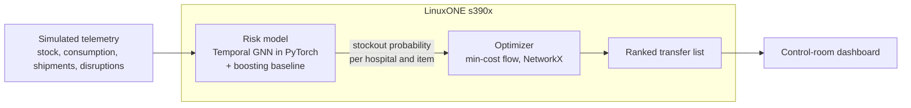

# ResQ-Stream: Real-Time Predictive Supply Chain and Inventory Routing for Critical Medical Shortages

IBM Z Datathon 2026 | Event code: **SSF2026** | Team: **[TEAM NAME]**

Hospitals learn about shortages after they happen, and streaming patient and logistics data to third-party clouds creates compliance risk. ResQ-Stream predicts stockouts hours ahead and recommends inventory transfers **before** a stockout, with all processing on IBM LinuxONE (s390x).



## Results (simulated data; 30-day test the model never trained on)
| | No rerouting | ResQ-Stream |
|---|---|---|
| Stockout episodes | 186 | 39 (-79%) |
| Stockout hospital-hours | 580 | 151 (-74%) |
| Unmet demand (units) | 3083 | 402 (-87%) |

Prediction (stockout within 6h): temporal GNN F1 0.69, PR-AUC 0.77; gradient boosting F1 0.89, PR-AUC 0.94; exponential smoothing F1 0.67. The boosting baseline is stronger on this synthetic data; both feed the same optimizer. Optimizer time: about 5 ms per decision.

## Run it (on the LinuxONE VM)
```bash
git clone https://github.com/yashas-sathal/ResQ-Stream.git && cd ResQ-Stream
jupyter notebook   # open notebooks/ResQ_Stream_Action_Stage.ipynb, Run All
python dashboard/build_dashboard.py   # writes dashboard/resq_dashboard.html
```
| Folder | Purpose |
|---|---|
| `data/` | Simulator and telemetry (train/test) |
| `model/` | Temporal GNN, baselines, ONNX export |
| `action/` | Min-cost-flow planner, closed-loop replay |
| `eval/` | Prediction metrics |
| `dashboard/` | Control-room HTML dashboard |

## IBM Z notes
- Runs on s390x (big-endian). The saved adjacency matrix needed conversion to native byte order (`model/gnn.py`).
- Plain PyTorch (no PyG) so it installs and runs on s390x.
- All data stays on the VM; no external cloud calls.

## Honest limitations
Data is **simulated**. Lane capacities are assumed (400 units). Donors' own reorder rules are not re-run in the replay. The planner does not know which lane a route closure hit. Telum acceleration, Kafka streaming, confidential computing and federated learning are **future work**, not demonstrated here.

## Open-source libraries
PyTorch, NumPy, pandas, scikit-learn, NetworkX, matplotlib, XGBoost (where available), ONNX / ONNX Runtime.
